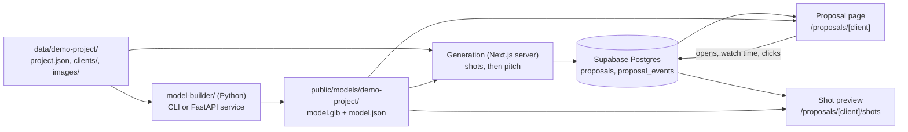

# Technical architecture

How the Project Proposal System is put together for the hackathon. Scope is in `AGENTS.md` section 0; this file covers the how.

## The system in one picture



There are two programs. The **web app** (Next.js, TypeScript) is the only backend the browser talks to. The **model builder** (Python) turns the pre-loaded project into a 3D model file. They share two things: the `data/` folder as input, and the model file as the handoff.

## Stack

| Layer | Choice |
|---|---|
| Web app and API | Next.js 16 (App Router, Node runtime), TypeScript, Tailwind CSS 4 |
| 3D in the browser | three.js through React Three Fiber and drei |
| Validation and contracts | Zod (web), Pydantic (Python) |
| Model builder | Python 3.11+, managed with uv; FastAPI + uvicorn for the service |
| Database | Supabase Postgres |
| Pre-loaded data | JSON and image files in `data/` |

## Decisions

1. **One web backend.** All browser-facing API routes are Next.js route handlers. FastAPI is not a general backend; it only wraps the model builder.
2. **The model builder is Python, with two entry points over one function.** `build_model()` in `model-builder/src/model_builder/build.py` does the work. `model-builder build <project>` runs it from the command line. `model-builder serve` exposes it over HTTP so the web app can start a build and poll it. Use whichever the demo needs; nothing else changes.
3. **The handoff is a GLB file plus `model.json`.** The builder writes both to `public/models/<project>/`. The web app treats the presence of `model.json` as "a model exists" and shows a gray-box stand-in until then.
4. **A shot is data, not video.** A shot carries a camera path (keyframes of position and target, plus field of view). The browser plays it live through the 3D viewer. Nothing is rendered to video.
5. **One viewer, two uses.** The proposal page's opening fly-up and the shot preview are the same `ModelViewer` component playing different camera paths.
6. **Pre-loaded data lives in the repo as files.** `data/demo-project/` holds the project, the clients and their needs, and the reference images. There is no live research and no needs classification.
7. **Generated proposals live in Supabase.** Generation writes one row per client to `proposals` with status `draft`. The pages read from there. Tracking events go to `proposal_events`.
8. **The pages work without Supabase.** With no keys set, each client shows a prepared proposal chosen by its need (`supabase/seed/prepared-proposals.json`, loaded through `src/lib/proposals.ts`). Proposal status and tracking events are held in process memory, which is fine for a laptop demo and lost on restart. With keys set, Supabase is used.
9. **Cache Components is off** (`cacheComponents: false` in `next.config.ts`). Pages read the files and the database on every request, so a new model or proposal appears without a rebuild.
10. **LLM output is always parsed against a Zod schema** (`shotListSchema`, `pitchSchema`) before it is stored or shown.

### Not decided yet

- The LLM provider for shot and pitch generation (`LLM_API_KEY` is a placeholder name).
- The geometry libraries inside the model builder.
- How Matterport fits in.
- The final format of the shot preview beyond playing camera paths.
- Where the model builder service runs on demo day. A build is too long for a serverless function, so the assumption is a laptop.

## Contracts

These are the shapes teammates depend on. Changing one is a contract change: post on the board when it lands.

| Contract | Defined in | Used by |
|---|---|---|
| Project and client data | `src/features/project/schema.ts` | `data/` files, generation, pages, model builder input |
| Model metadata (`model.json`) | `src/features/model/schema.ts` and `model-builder/src/model_builder/contract.py` (kept identical) | model builder output, viewer, shot generation |
| Build status | `src/features/model/service.ts` and `model-builder/src/model_builder/api.py` (kept identical) | model build API |
| Shot and camera path | `src/features/shots/schema.ts` | shot generation, viewer, shot preview |
| Pitch | `src/features/pitch/schema.ts` | pitch generation, proposal page |
| Proposal | `src/features/proposal/schema.ts` and the `proposals` table | generation, pages |
| Tracking event | `src/features/tracking/schema.ts` and the `proposal_events` table | proposal page, tracking API |

### Coordinates

The model, the camera paths and the viewer all use the same space: meters, glTF convention, **+Y up, +X east, -Z north**. The origin is the center of the building footprint at ground level. Shots frame only the sides listed in the model's `knownSides`.

## Flows

**Building the model**

1. `uv run model-builder build demo-project`, or `POST /api/model/builds` from the web app, which forwards to the Python service at `MODEL_BUILDER_URL`.
2. `build_model()` reads `data/demo-project/` and writes `model.glb`, then `model.json`.
3. The next page load picks up the model.

**Generating a proposal**

1. `POST /api/proposals/<client>/generate`.
2. `generateProposal()` loads the project, the client and the model info, calls `generateShots()`, then `generatePitch()`.
3. The result is saved to `proposals` as a `draft` for a person to review.

**Viewing a proposal**

1. `/proposals/<client>` loads the client, the model info and the stored proposal.
2. The page opens on the teaser camera path, then shows the pitch.
3. `/proposals/<client>/shots` lists the shots and plays the selected one.
4. The page posts open, watch and click events to `POST /api/track`.

## API

| Route | Does | Status today |
|---|---|---|
| `POST /api/proposals/[client]/generate` | Generates and stores a draft proposal | 501 until shot and pitch generation exist |
| `POST /api/track` | Records an open, watch or click event | Works once Supabase keys are set; 503 without them |
| `POST /api/model/builds` | Starts a model build on the Python service | Works; the build itself fails until `build_model()` exists |
| `GET /api/model/builds/[id]` | Reports a build's status | Works |

Python service: `GET /health`, `POST /builds`, `GET /builds/{id}`. Builds are held in memory and run one at a time.

## Repository layout

```
data/demo-project/        pre-loaded project, clients, images
model-builder/            Python package: build.py, cli.py, api.py, contract.py, tests/
public/models/            model builder output (GLB files are gitignored)
src/
  app/
    page.tsx                      client list
    proposals/[client]/           proposal page
    proposals/[client]/shots/     shot preview
    api/                          routes in the table above
  features/
    project/      schema and loaders for data/
    model/        model.json schema, loader, client for the Python service
    viewer/       ModelViewer and camera paths
    shots/        shot schema, generation, ShotPreview
    pitch/        pitch schema, generation
    proposal/     proposal schema, store, generation pipeline
    tracking/     event schema and recording
  lib/supabase/   Supabase clients
supabase/migrations/      proposals and proposal_events tables
```

## What is a stub

- `build_model()` in the model builder.
- `generateShots()` and `generatePitch()`.
- Review and send: `status` exists on a proposal, but there is no review screen.
- The proposal page does not post tracking events yet, and has no "book a call" button.
- `data/demo-project/` holds sample values, not the real demo project.
- `src/types/database.ts` is a placeholder until types are generated from the database.

## Running it

```bash
npm install
cp .env.example .env.local
npm run dev                         # web app on http://localhost:3000

cd model-builder && uv sync
uv run model-builder serve          # Python service on http://127.0.0.1:8000
```

Checks: `npm run lint && npm run typecheck` for the web app, `uv run pytest` in `model-builder/`.
